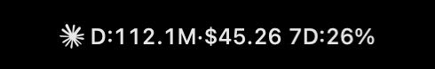
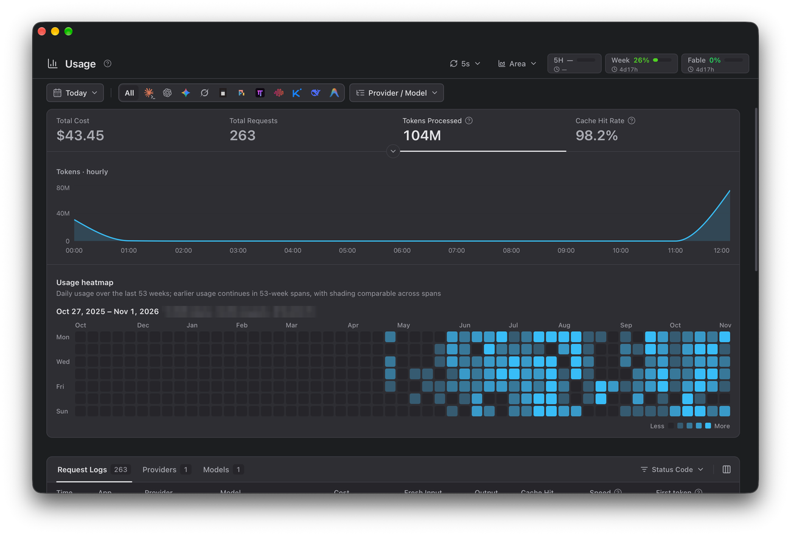
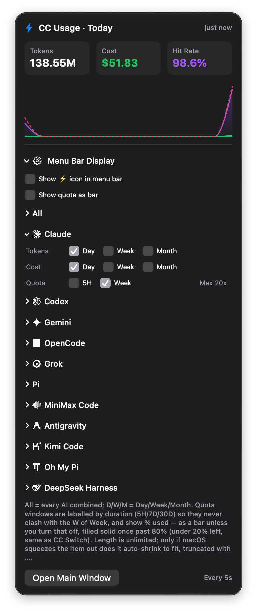
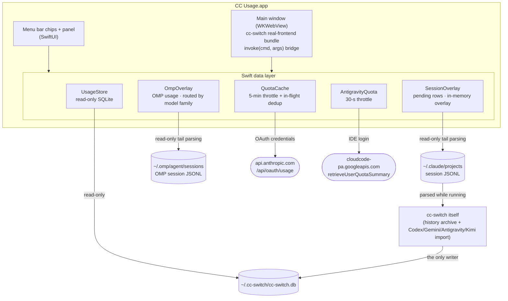

<div align="center">

# CC Usage

**Real-time Claude Code / Codex / Gemini usage in your macOS menu bar**

A native companion app derived from the Usage dashboard of [cc-switch](https://github.com/farion1231/cc-switch)

English | [简体中文](README.zh-CN.md)



</div>

---

## What is this

The Usage dashboard in [cc-switch](https://github.com/farion1231/cc-switch) is great, but it lives inside a tab of the main app. CC Usage makes it **always visible**:

- **Menu bar chips**: today's tokens & cost plus your official 5H / Weekly subscription quota, refreshed every 5 seconds;
- **A standalone main window** embedding cc-switch's **real frontend** (not a lookalike) — numbers, charts and interactions are pixel-identical to upstream.

<div align="center">

<br><br>

</div>

## Features

- ⚡ **Composable menu bar chips**: Tokens & cost for today / last 7 days / last 30 days (D/W/M — whole calendar days counting today, the same windows as the main window's 7d / 30d), plus official 5H / Weekly quota percentages — pick any combination; per-AI groups (Claude / Codex / Gemini / OpenCode / Grok / Pi / MiniMax Code / Antigravity / Kimi Code)
- 🧩 **Grok group**: Tokens/Cost chips for `grokbuild` usage; xAI has **no public remaining/utilization API**, so Quota shows `No quota API` like Gemini/OpenCode (no fabricated percentages)
- 📊 **The real dashboard, 1:1**: the main window runs the actual frontend build of cc-switch v4.0.20's Usage page — a metric strip that picks what the genuine Recharts trend chart plots (bars or area, hover tooltips identical to upstream), an always-on 53-week heatmap, a scope bar with date ranges including "All", app chips (following cc-switch's Apps-page visibility) and one cascading provider → model menu, and the Request Logs / Providers / Models tabs with counts, success rate, output speed and first-token time (≈ marks values estimated from session logs). Choose which request-log columns to show (cache write, hit rate, total time, status code…) and 10 / 20 / 50 rows per page; your date range, tab, metric and page size are remembered. Click any request for its full breakdown. It is read-only: everything that would write to cc-switch (sync, rebuild, pricing edits, its usage settings) is left out
- 🔄 **5-second live refresh**: choose 5/10/30/60s or off; the choice persists, and the menu bar and main window share one refresh cadence so they never disagree
- 🔋 **Official subscription quota**: queries Anthropic's `/api/oauth/usage` with your local Claude Code OAuth credentials, throttled to once per 5 minutes with an in-process shared cache (no 429s); shown from the very first paint
- 🛰️ **Antigravity quota**: reads the Antigravity IDE's local login and asks Google's quota summary — the endpoint cc-switch's official Antigravity card uses — for the Gemini and Claude/GPT groups' 5-hour and weekly windows (whichever ones Google reports for your plan)
- 🔌 **Live even with cc-switch closed**: a built-in read-only overlay incrementally parses Claude Code session logs and prices them with cc-switch's own pricing table; when cc-switch imports those rows later the overlay drains via exact request-id dedup — verified seamless handoff, zero double counting
- 🧬 **OMP usage no longer missing**: [Oh My Pi](https://github.com/sst/omp) writes its sessions to `~/.omp/agent/sessions`, whose usage cc-switch **doesn't import** (v4.0.20 manages OMP's config and browses its sessions, but its release notes say usage isn't counted) — the app parses it read-only and **routes each row by model family**: Claude requests count as Claude, Grok requests count as Grok, never lumped together; costs come from OMP's own figures (custom gateways simply don't exist in cc-switch's pricing table)
- 🪟 **Well-behaved windowing**: a single unique main window; closing it keeps the menu bar resident

## Prerequisites (read this)

> [!IMPORTANT]
>
> 1. **macOS 14 (Sonoma) or later**;
> 2. [cc-switch](https://github.com/farion1231/cc-switch) (≥ 3.16 recommended) installed — it owns the local database, history and pricing table; this app reads its database **read-only**.
>    **cc-switch does NOT need to be running**: while it's closed, the app incrementally parses Claude Code's session logs (`~/.claude/projects`) itself and overlays the not-yet-imported usage in real time; when cc-switch comes back and imports those rows, the overlay deduplicates by request id and hands off seamlessly with no double counting (importing **new** Codex / Gemini / Antigravity / Kimi Code usage still requires cc-switch to run — Antigravity and Kimi Code need cc-switch v4.0.18 / v4.0.19 or later);
>    If you use [OMP](https://github.com/sst/omp), its usage likewise needs no cc-switch — see "How it works" below;
> 3. The Claude quota chips/badges require a Claude Code login on this machine (OAuth credentials are read from the Keychain — your macOS account's entry first — or `~/.claude/.credentials.json`); Antigravity quota needs the Antigravity IDE to be signed in.

## Install

### Option 1: download a Release (recommended)

1. Grab `CC.Usage.app.zip` from [Releases](https://github.com/Eureka0w0v0/cc-usage/releases) and unzip;
2. Drag `CC Usage.app` into Applications;
3. The app is ad-hoc signed (personal open-source project, no paid developer certificate), so clear the quarantine flag before first launch:

```bash
xattr -d com.apple.quarantine "/Applications/CC Usage.app"
```

### Option 2: build from source

Requires full Xcode and [XcodeGen](https://github.com/yonaskolb/XcodeGen) (`brew install xcodegen`):

```bash
git clone https://github.com/Eureka0w0v0/cc-usage.git
cd cc-usage
bash scripts/build.sh   # generate project → Release build → install to /Applications and launch
```

## Usage notes

- **Menu bar chips**: click CC Usage's item in the menu bar → expand "Menu Bar Display" → open an AI group (All / Claude / Codex / …) and tick what you want (Tokens/Cost each offer Day/Week/Month; Quota offers 5H/Week, and Antigravity's offers Gemini / Claude × 5H / 7D). The label renders like `D:154.9M 5H:8% 7D:45%`, behind each AI's icon;
- **Refresh interval**: the ⟳ dropdown in the main-window header; it applies to both the panel and the menu bar, and persists across restarts;
- **Chart style and columns**: the chart dropdown beside it switches the trend chart between bars and area; which request-log columns show is set in the columns menu at the right end of the Request Logs tab bar. Both persist;
- **Quota update cadence**: the 5H/Week percentages change **at most once per 5 minutes** — the official endpoint is throttled exactly like cc-switch does to avoid rate-limiting your account. Tokens/cost from the local database are the truly-every-5-seconds numbers;
- Date/provider/model filters and the three stats tabs behave exactly like upstream cc-switch; the Providers / Models tables include daily rollups, so their rows add up to the totals at the top. Requests that cc-switch hasn't imported yet get the same speed and first-token estimates (marked ≈) that cc-switch computes from the session logs, so the values don't change when it imports them; OMP requests use OMP's own measured duration and time to first token. As in cc-switch, replies under 200 output tokens get no speed, and only replies that open with a thinking block get a first-token time.

## How it works



- The main window is not a re-implementation: cc-switch's frontend source plus a thin `invoke` bridge (`embed/`) is compiled by Vite into a single-file `index.html` running in a WKWebView. Tauri `invoke` calls from the frontend are intercepted in Swift and answered straight from the local SQLite database — aggregation semantics faithfully reimplement cc-switch's `usage_stats.rs`;
- While cc-switch is closed, `SessionOverlay` resumes from the line offsets cc-switch recorded in `session_log_sync` and read-only parses the session JSONL tails, mirroring its importer (`session_usage.rs`) rule by rule — parsing, dedup and pricing alike (model ids match pricing rows case-insensitively, as in cc-switch). Pricing follows the cc-switch version you have installed: from v4.0.7 on, Claude's 1-hour cache writes cost 1.6× the 5-minute rate and the overlay bills them the same way; with an older cc-switch (e.g. 3.20.x), which bills every cache write at the 5-minute rate, the overlay does too, so the numbers don't jump when the rows get imported. Request duration and first-token time are estimated the way cc-switch v4.0.12 does it — from timestamps along the conversation chain (kept across reads, plus the same 256 KB look-behind before cc-switch's cursor) — and match cc-switch's own import row for row. The pending rows are merged into every query in memory and drain to zero via exact `request_id` dedup once cc-switch imports them: nothing is ever written, nothing is ever counted twice;
- OMP usage is a different story: cc-switch doesn't import usage from `~/.omp/agent/sessions` (v4.0.20 manages OMP and browses its sessions, but leaves usage out), so those rows will **not** land in the database on their own — `OmpOverlay` is not a stopgap awaiting import, it is their only source. Attribution is decided by **model family**, not provider name: one provider can serve models from several families, and which ledger a request belongs to depends on whose model it hit, so Claude models must land in the Claude bucket (and if OMP shares a subscription account with Claude Code, that spend is the very quota the 5H/Week badge reports — get the bucket wrong and the panel contradicts itself with a rising quota percentage next to motionless token counts). Grok through a custom gateway lands in the Grok bucket. Costs are taken verbatim from OMP (only its `models.yml` prices those custom endpoints), and so are duration and time to first token, which OMP measures for every reply. When the response id is an Anthropic `msg_xxx`, the request id reuses cc-switch's own `session:<msg_id>` namespace — which both prevents double counting against `SessionOverlay` and lets the row drain automatically should it ever get imported;
- Subscription quota uses your local Claude Code OAuth credentials; results live in one in-process shared cache read by both the menu bar and the panel, which is why the two always agree. Antigravity quota comes from Google's quota summary with the Antigravity IDE's local login — the request names CC Usage plus the `antigravity/cli/<version>` client tag Google requires before it returns the Gemini group.

## Rebuilding the panel frontend (optional)

A prebuilt `Sources/App/web-panel/index.html` ships with the repo, so normal builds **don't need this**. To track upstream cc-switch updates:

```bash
git clone https://github.com/farion1231/cc-switch ../cc-switch   # or point to your existing clone
CC_SWITCH_DIR=../cc-switch bash scripts/build-embed.sh
```

The script copies the bridge files under `embed/` into the cc-switch tree (all additive — no upstream source file is modified; `pnpm add` does update its package.json/lockfile to pull in the bundling plugin), builds the single-file panel with pnpm + Vite and writes it back into this repo.

> [!NOTE]
> The bridge layer is verified against a **specific cc-switch commit** (see `CC_SWITCH_REF` in the script). If your checkout is on a different commit the script warns; set `CC_SWITCH_CHECKOUT=1` to switch automatically, or bump `CC_SWITCH_REF` after verifying a newer upstream.

Two more read-only scripts round out an upstream sync — neither writes to cc-switch:

```bash
CC_SWITCH_DIR=../cc-switch bash scripts/sync-pricing.sh      # rebuild the built-in pricing fallback
CC_SWITCH_DIR=../cc-switch bash scripts/check-app-types.sh   # diff app types / session provider names
```

`check-app-types.sh` cross-checks three truth sources that upstream touches whenever it adds a harness — the usage app set (`KNOWN_APP_TYPES`), the session placeholder `provider_id` → display-name map, and the cache-inclusive app whitelist. Nothing used to flag a drift here, which is exactly how `pi` and `mcode` each went a release without being picked up.

## Development

```bash
bash scripts/test.sh    # unit tests: pricing candidates / rollup bounds / two-table
                        # merge without double counting / overlay parsing /
                        # OMP attribution routing and dedup, etc.
                        # All run against temp sqlite + temp dirs — real data untouched.
```

Pushes and PRs trigger a GitHub Actions smoke build + tests (`.github/workflows/build.yml`).

## Privacy

- All usage data stays **on your machine**: the app reads cc-switch's SQLite database, the app visibility in its `settings.json` and local session logs (`~/.claude/projects`, `~/.omp/agent/sessions`) read-only, writes to none of them, and uploads nothing;
- Network requests: Anthropic's official quota endpoint `api.anthropic.com/api/oauth/usage` (only while a Claude quota chip is on or the main window — whose header shows the quota badges — is open; at most once per 5 minutes); Google's `oauth2.googleapis.com` / `cloudcode-pa.googleapis.com` for Antigravity quota (only while an Antigravity quota chip is ticked or its settings group is open; at most once per 30 seconds); and an anonymous check of this repo's latest GitHub release (at most every 6 hours);
- OAuth credentials are read locally, never persisted elsewhere, and only ever sent to their own provider.

## Credits & License

- This project is a derivative work of [cc-switch](https://github.com/farion1231/cc-switch) (MIT, © [@farion1231](https://github.com/farion1231)): the main-window panel is built directly from its frontend source, and the statistics semantics mirror its backend line by line. Huge thanks to the original author;
- Released under the [MIT License](LICENSE); see [THIRD_PARTY_NOTICES.md](THIRD_PARTY_NOTICES.md) for bundled third-party code.
