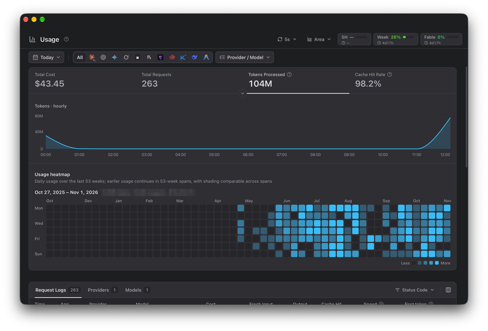
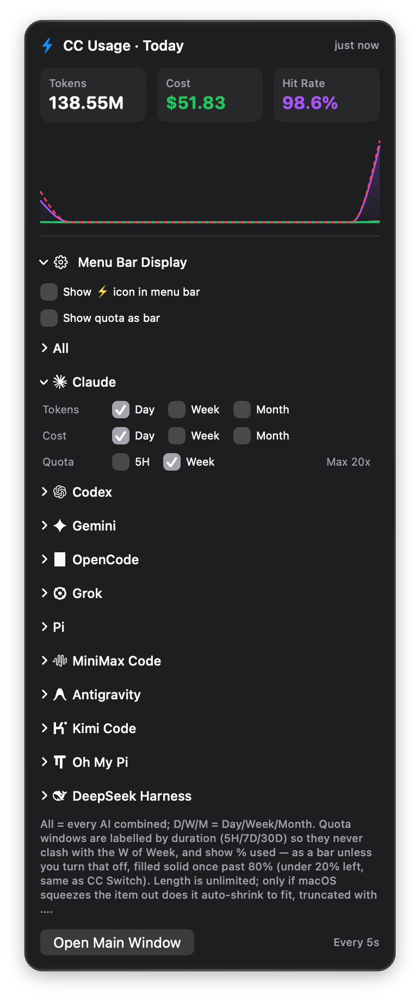
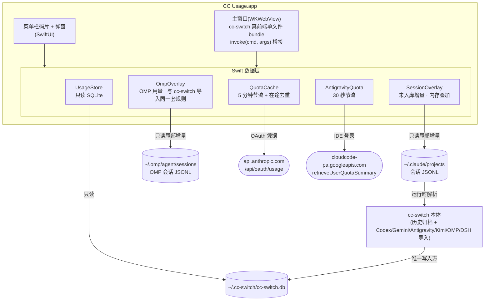

<div align="center">

# CC Usage

**macOS 菜单栏里的 Claude Code / Codex / Gemini 用量实时看板**

基于 [cc-switch](https://github.com/farion1231/cc-switch) Usage 面板二次开发的原生伴侣应用

[English](README.md) | 简体中文


</div>

---

## 这是什么

[cc-switch](https://github.com/farion1231/cc-switch) 的「用量统计」面板很好用,但它藏在主程序的一个标签页里。CC Usage 把它搬出来**常驻**:

- **菜单栏码片**:今日 tokens·花费、5H/Week 官方订阅额度百分比,一眼可见,5 秒实时刷新;
- **独立主窗口**:内嵌 cc-switch **真实前端**(不是仿制)的完整 Usage 面板,数字、图表、交互与原版逐像素一致。

<div align="center">

<br><br>

</div>

## 功能

- ⚡ **菜单栏码片自由组合**:今日 / 近 7 天 / 近 30 天的 Tokens 与花费(D/W/M,按自然日算、含今天,与主窗口的 7d / 30d 同一口径),外加 5H / Week 官方额度百分比,想看哪个勾哪个;支持按 AI 分组(Claude / Codex / Gemini / OpenCode / Grok / Pi / MiniMax Code / Antigravity / Kimi Code / Oh My Pi / DeepSeek Harness)
- 🧩 **Grok 分组**:可勾选 `grokbuild` 用量 Tokens/Cost;xAI **无公开 remaining/utilization 查询接口**,Quota 行与 Gemini/OpenCode 一样标注 `No quota API`(不做伪造百分比)
- 📊 **1:1 真面板**:主窗口直接运行 cc-switch v4.0.22「用量统计」页的前端构建产物——点选指标条决定真 Recharts 趋势图画什么(柱形或面积,悬停提示与原版一致)、常驻的 53 周热力图、范围栏(含「全部」的日期范围、按 cc-switch「应用」页显示设置过滤的应用码片、供应商 → 模型的级联菜单),以及带数量、成功率、输出速度、首字时间的 Request Logs / Providers / Models 三个页签(≈ 表示按会话日志估算的值)。请求日志可以自选显示的列(缓存写入、命中率、总耗时、状态码……),每页 10 / 20 / 50 条;日期范围、页签、指标和每页条数都会记住。点任意一条请求可看完整明细。面板只读:会写 cc-switch 的功能(同步、重建、改价、它的用量设置)一律不放
- 🔄 **5 秒实时刷新**:间隔可选 5/10/30/60 秒或关闭,选择持久化;菜单栏与主窗口共享同一个刷新节奏,数字永远一致
- 🔋 **官方订阅额度**:读取本机 Claude Code 的 OAuth 凭据查询官方 `/api/oauth/usage`,5 分钟节流 + 进程内共享缓存,绝不打爆接口(429);首屏即显,无需等待
- 🛰️ **Antigravity 额度**:读取本机 Antigravity IDE 的登录,向 Google 的额度汇总接口(cc-switch 官方 Antigravity 卡用的同一个)查询 Gemini、Claude/GPT 两组的 5 小时与每周窗口(你的套餐返回哪些就显示哪些)
- 🔌 **cc-switch 关闭也照常实时**:内置只读「未入库增量」叠加层,直接增量解析 Claude Code 会话日志并按 cc-switch 的价格表现场定价;cc-switch 补录入库时自动去重收敛,实测数字无缝交接
- 🧬 **OMP 用量实时可见、只算一次**:[Oh My Pi](https://github.com/sst/omp) 把会话写在 `~/.omp/agent/sessions`,cc-switch 从 v4.0.22 起把它当独立应用导入用量。本应用叠加 cc-switch 还没导入的部分,解析规则、request_id 和计价都与 cc-switch 的导入器一致,导入前后数字不跳;cc-switch 已有的行会被剔除(明细被汇总删掉后也一样)。cc-switch 低于 4.0.22 时,叠加层就是 OMP 用量的唯一来源。OMP 单独成组
- 🪟 **克制的窗口行为**:主窗口全局唯一,关掉后菜单栏继续常驻

## 前置条件(必读)

> [!IMPORTANT]
>
> 1. **macOS 14 (Sonoma) 及以上**;
> 2. 已安装 [cc-switch](https://github.com/farion1231/cc-switch)(建议 ≥ 3.16)——历史数据、价格表与数据库都由它建立维护,本应用对其库**只读**;
>    **cc-switch 不需要保持运行**:它关闭时,应用会直接增量解析 Claude Code 的会话日志(`~/.claude/projects`),把尚未入库的用量实时叠加显示,等 cc-switch 回来补录时按 request_id 精确去重、无缝交接不双算(Codex / Gemini / Antigravity / Kimi Code / DeepSeek Harness 的**新增**用量仍需 cc-switch 运行导入,其中 Antigravity、Kimi Code、DeepSeek Harness 需要 cc-switch v4.0.18 / v4.0.19 / v4.0.22 及以上);
>    装了 [OMP](https://github.com/sst/omp) 的话,它的用量同样不需要 cc-switch——见下方「工作原理」;
> 3. Claude 额度徽标(5H/Week)需要本机登录过 Claude Code(从 Keychain 读取 OAuth 凭据,优先取当前 macOS 账户的那一条,或读 `~/.claude/.credentials.json`);Antigravity 额度需要 Antigravity IDE 已登录。

## 安装

### 方式一:下载 Release(推荐)

1. 从 [Releases](https://github.com/Eureka0w0v0/cc-usage/releases) 下载 `CC.Usage.app.zip` 并解压;
2. 把 `CC Usage.app` 拖进「应用程序」;
3. 应用是 ad-hoc 签名(个人开源项目,没有付费开发者证书),首次打开前需要去掉隔离属性:

```bash
xattr -d com.apple.quarantine "/Applications/CC Usage.app"
```

### 方式二:源码构建

需要完整 Xcode 与 [XcodeGen](https://github.com/yonaskolb/XcodeGen)(`brew install xcodegen`):

```bash
git clone https://github.com/Eureka0w0v0/cc-usage.git
cd cc-usage
bash scripts/build.sh   # 生成工程 → Release 构建 → 安装到 /Applications 并启动
```

## 使用说明

- **菜单栏显示项**:点菜单栏里的 CC Usage → 展开「Menu Bar Display」→ 展开某个 AI 分组(All / Claude / Codex / …)勾选想要的码片(Tokens/Cost 各含 Day/Week/Month,Quota 含 5H/Week;Antigravity 的 Quota 是 Gemini / Claude × 5H / 7D)。菜单栏显示格式如 `D:154.9M 5H:8% 7D:45%`,前面是对应 AI 的图标;
- **刷新间隔**:主窗口页头的 ⟳ 下拉选择,菜单栏与面板同步生效并持久化;
- **图表样式和列**:旁边的图表下拉切换趋势图的柱形 / 面积;请求日志显示哪些列在「请求日志」页签栏右端的列菜单里选。都会记住。菜单栏弹窗里的今日小时图跟着同一个样式,画的是主窗口指标条选中的指标,鼠标停在上面能看到那一小时的数值;
- **额度的更新节奏**:5H/Week 的百分比**最快 5 分钟变一次**——官方接口按 cc-switch 同款设计做了 5 分钟节流,防止账号被限流。本地库的 tokens/花费才是真·5 秒一变;
- **Claude 套餐**:套餐名(如 `Ultra`)显示在主窗口额度徽标左边和菜单栏 Claude 组 Quota 行末尾。和 Claude Code 一样优先用 Anthropic 服务器下发的套餐名(Claude Code 缓存在 `~/.claude.json` 里),官方改名不用等本应用更新;读不到时按凭据推断(2026-10-30 起 Max 20x 改名 Ultra、Max 5x 改名 Max)。它随额度一起读取,拉过额度后才出现;
- **日期/供应商/模型筛选、三个统计页签**:与 cc-switch 原版完全一致;供应商/模型表把日汇总也算进去,各行加起来等于顶部总数。cc-switch 还没导入的请求,速度和首字按 cc-switch 同一套规则从会话日志估算(带 ≈),导入前后数值不变;OMP 的请求用 OMP 每条回复自己测的耗时,和 cc-switch 一样没有首字时间。和 cc-switch 一样,输出不到 200 token 的短回复不估速度,只有以思考块开头的回复推得出首字。

## 工作原理



- 主窗口不是仿制界面,而是把 cc-switch 的前端源码加一层 `invoke` 桥接(`embed/`)后用 Vite 编译成单文件 `index.html`,跑在 WKWebView 里;前端发出的 Tauri `invoke` 调用被 Swift 拦下,直接查本地 SQLite 返回——统计口径逐条复刻 cc-switch 的 `usage_stats.rs`;
- cc-switch 不在运行时,`SessionOverlay` 按 cc-switch 记录的行偏移(`session_log_sync`)只读续解析会话 JSONL,解析与定价规则逐条对齐其导入器(`session_usage.rs`,模型 id 查价同样不分大小写)。定价跟着本机装的 cc-switch 版本走:v4.0.7 起 Claude 的 1 小时缓存写入按 5 分钟写入价的 1.6 倍计,叠加层同样这么算;装的是更早的版本(如 3.20.x)时,它入库一律按 5 分钟价,叠加层也按 5 分钟价,入库前后数字不跳;耗时和首字也照 cc-switch v4.0.12 的办法估——沿对话链找发起这次请求的那一行(对话链跨轮保留,cc-switch 游标前同样回看 256KB),用时间戳相减,与 cc-switch 自己导入的值逐条一致;这些「未入库增量」在内存里并进所有查询,cc-switch 回来入库时按 `request_id` 精确去重、自动收敛为零——全程不写库,绝无双算;
- OMP 的用量从 cc-switch v4.0.22 起也是同样的套路:它把 `~/.omp/agent/sessions` 当独立应用(`omp`)导入。`OmpOverlay` 产出的正是 cc-switch 此刻做一次全量导入会得到的那些行——文件发现、逐条解析、request_id(`omp_session:<sha256>`)、跨文件去重和计价都逐条移植自 cc-switch 的导入器,并在真实会话数据上与它对拍过——再剔除 id 已在 `proxy_request_logs` 或 cc-switch 去重账本 `session_usage_dedup` 里的行(明细被汇总删掉后账本仍在)。中断或报错的请求和 cc-switch 一样记一条请求、状态码 499 / 500;自报成本为 0 的回复按 cc-switch 的价格表计价,查不到再用内置表。cc-switch 低于 4.0.22 时不会有导入,叠加层就是唯一来源;
- 订阅额度走你本机的 Claude Code OAuth 凭据,查询结果在进程内共享缓存,菜单栏与面板读同一份,所以两边永远一致。Antigravity 额度用 Antigravity IDE 的本机登录查 Google 的额度汇总——请求里照实写 CC Usage,并带上 Google 要求的 `antigravity/cli/<版本>` 客户端标识,否则不返回 Gemini 那组。

## 重建面板前端(可选)

仓库已内置编译好的 `Sources/App/web-panel/index.html`,普通构建**不需要**这一步。cc-switch 上游更新后想跟进面板时:

```bash
git clone https://github.com/farion1231/cc-switch ../cc-switch   # 或指向你已有的 clone
CC_SWITCH_DIR=../cc-switch bash scripts/build-embed.sh
```

脚本会把 `embed/` 下的桥接文件(全部为新增文件,不改动上游任何源文件;`pnpm add` 会更新其 package.json/lockfile 以引入打包插件)铺进 cc-switch 源码树,用 pnpm + Vite 构建单文件面板并写回本仓库。

> [!NOTE]
> 桥接层是对着 cc-switch 的**特定提交**验证的(见脚本内 `CC_SWITCH_REF`)。若本地 checkout 不在该提交上,脚本会给出警告;`CC_SWITCH_CHECKOUT=1` 可自动切换,或在验证新上游后更新 `CC_SWITCH_REF`。

一轮上游同步还有另外两个只读脚本,都不会写 cc-switch:

```bash
CC_SWITCH_DIR=../cc-switch bash scripts/sync-pricing.sh      # 重建内置定价兜底表
CC_SWITCH_DIR=../cc-switch bash scripts/check-app-types.sh   # 对拍 app 全集与会话来源占位名
```

`check-app-types.sh` 对拍上游每加一种 harness 都会动的三处真理源:用量 app 全集(`KNOWN_APP_TYPES`)、会话占位 `provider_id` → 可读名映射、以及 cache-inclusive 白名单。此前没有任何机制会在这里报警,`pi` 与 `mcode` 各漏了一轮才被发现。

## 开发

```bash
bash scripts/test.sh    # 单元测试:定价匹配 / rollup 边界 / 两表合并防双算 /
                        # overlay 解析 / OMP 解析、id 与去重(对齐 cc-switch)等
                        # 全部对着临时 sqlite 与临时目录,不读写真实数据
```

推送与 PR 会触发 GitHub Actions 的 smoke build + 测试(`.github/workflows/build.yml`)。

`Sources/App` 是应用外壳:视图、WebView 桥接、网络和钥匙串。`Sources/Shared` 编进 App、Widget 和测试,按领域分目录:`Usage/`(只读查询层)、`Overlay/`(会话日志里的未入库增量)、`Pricing/`、`Quota/`(解析与展示类型)、`Chart/`、`MenuBar/`(宽度状态机、码片键、取数)、`Bridge/`(和前端的 JSON 契约)。依赖单向:`App → Usage → Overlay → Pricing → SQLite 小工具`。

单元测试看不到的回归靠三个工具,都不碰已安装的 App,真实数据只读、只用拷贝:

- `Tools/dump`:用冻结的数据副本跑全部查询,新旧代码逐字节对拍;按小块回放会话日志,含 cc-switch 中途入库;
- `Tools/smoke`:无头 Chrome 跑真前端 + 真桥接,逐个页签点开;
- `Tools/render`:菜单栏合成图和设置面板的离屏对拍。

## 隐私

- 所有用量数据**只在本机**:只读 cc-switch 的 SQLite 库、它 `settings.json` 里的应用显示设置、本地会话日志(`~/.claude/projects`、`~/.omp/agent/sessions`)以及 Claude Code 缓存在 `~/.claude.json` 里的套餐名(只取这一个字段),不上传任何内容,也不写这些文件;
- 网络请求:Anthropic 官方额度接口 `api.anthropic.com/api/oauth/usage`(仅在勾了 Claude 额度码片、或开着主窗口(页头有额度徽标)时,5 分钟最多一次);Antigravity 额度用到的 Google `oauth2.googleapis.com` / `cloudcode-pa.googleapis.com`(仅在勾了 Antigravity 额度码片或展开它的设置分组时,30 秒最多一次);匿名检查本仓库在 GitHub 的最新版本(6 小时最多一次);
- OAuth 凭据仅在本机读取使用,不落盘,只发给各自的官方接口。

## 致谢与许可

- 本项目是 [cc-switch](https://github.com/farion1231/cc-switch)(MIT, © [@farion1231](https://github.com/farion1231))的二次开发:主窗口面板由其前端源码直接构建,统计口径与其后端逐条对齐。感谢原作者的优秀工作;
- 本项目以 [MIT](LICENSE) 许可开源,随附的第三方代码声明见 [THIRD_PARTY_NOTICES.md](THIRD_PARTY_NOTICES.md)。
